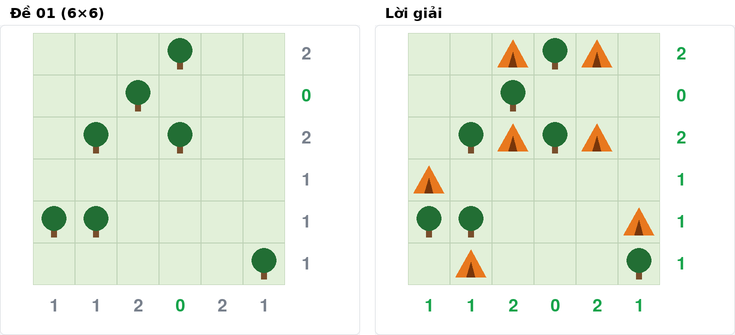

# Phiếu bàn giao kỹ thuật – Tents – TV3

Ngày 26/10/2026 · TV3

## 1. Luật chơi

Tents (puzzle-tents.com) cho một lưới R×C có sẵn một số cây. Người chơi phải đặt lều sao cho mỗi cây có đúng một lều ở ô kề cạnh (trên, dưới, trái, phải), và mỗi lều thuộc đúng một cây. Hai lều không được chạm nhau, kể cả theo đường chéo. Số lều trên mỗi hàng và mỗi cột phải bằng số gợi ý ghi ở cuối hàng và cuối cột.



Đề nhỏ nhất (01, 6×6, 7 cây) và lời giải duy nhất, chụp từ `gui/app.py` với trace A\* của đề này. Số gợi ý chuyển sang màu xanh khi hàng hoặc cột đã đủ lều.

## 2. Dữ liệu đầu vào

**Định dạng file** `inputs/tents/NN.txt`:

- Dòng 1: `R C` (số hàng, số cột).
- R dòng tiếp theo: lưới, `T` là cây, `.` là ô trống.
- Dòng kế: R số, là số lều của từng hàng.
- Dòng cuối: C số, là số lều của từng cột.

| File | Kích thước | Số cây | Nguồn |
| --- | --- | --- | --- |
| 01, 02 | 6×6 | 7 | puzzle-tents.com |
| 03, 04 | 8×8 | 12 | puzzle-tents.com |
| 05, 06 | 10×10 | 20 | puzzle-tents.com |
| 07, 08 | 15×15 | 45 | puzzle-tents.com |
| 09 | 20×20 | 80 | puzzle-tents.com |
| 10 | 25×25 | 125 | puzzle-tents.com, đề Weekly |
| 11 | 30×30 | 180 | puzzle-tents.com, đề Monthly |

Tất cả lấy ngày 22/10/2026 từ ảnh chụp màn hình. Chi tiết từng đề ghi ở `inputs/tents/SOURCES.md`.

**Lời giải** nằm cạnh đề, tên `NN.sol.txt`: cùng lưới, `A` là lều.

**Cách kiểm chứng.** Site chỉ hiển thị đề bằng JavaScript, nên đề được chép từ ảnh chụp: script nhận diện cây theo màu pixel, số gợi ý đọc từ ảnh phóng to. Mỗi đề phải qua ba bước:

1. Tổng gợi ý hàng = tổng gợi ý cột = số cây.
2. Solver quay lui tìm được **đúng một** nghiệm. Chép sai một ô là đề vô nghiệm hoặc nhiều nghiệm.
3. Script độc lập `inputs/tents/tools/verify_tents_inputs.py` kiểm tra lời giải đủ ba luật, kể cả ghép cây với lều 1–1. Với các đề đến 10×10, script còn giải lại theo hàng để xác nhận nghiệm duy nhất.

## 3. Biểu diễn trạng thái

Trạng thái là một **tuple các ô đặt lều** (hàng, cột), đánh số từ 0. Phần tử thứ i là lều của cây thứ i; cây được đánh số theo hàng rồi cột. Độ dài tuple bằng số cây đã xử lý, cũng là g(n).

Vì sao chọn cách này:

- Tuple bất biến nên băm được, dùng thẳng cho tập CLOSED của A\* và tập visited của DFS.
- Luật "mỗi cây một lều, mỗi lều một cây" tự thỏa: mỗi vị trí trong tuple gắn với đúng một cây, và is\_valid cấm hai cây dùng chung ô.
- Gọn: trạng thái đầy đủ của đề 30×30 chỉ có 180 cặp số thay vì 900 ô. Lưới chỉ được dựng khi cần vẽ, qua `encode()`: trả về lưới (R+1)×(C+1) gồm bàn chơi, cột cuối là số gợi ý hàng, hàng cuối là số gợi ý cột.

Với đề 01, 7 cây theo thứ tự là (0,3), (1,2), (2,1), (2,3), (4,0), (4,1), (5,5).

- **Trạng thái đầu:** `()`
- **Trạng thái đích:** `((0,4), (0,2), (2,2), (2,4), (3,0), (5,1), (4,5))`

## 4. Không gian trạng thái

| Thành phần | Định nghĩa cho Tents |
| --- | --- |
| Trạng thái đầu | `()`, chưa đặt lều nào |
| Tập hành động | Với trạng thái dài k: các ô kề cạnh cây thứ k, nằm trong lưới và không phải cây (2 đến 4 ô) |
| Hàm chuyển (result) | result(s, a) = s + (a,): tuple mới, không sửa s |
| Kiểm tra hợp lệ (is\_valid) | Gọi sau khi sinh nút con. Loại nút nếu: (1) lều không kề cây của nó; (2) hai lều trùng ô; (3) hai lều chạm nhau theo 8 hướng; (4) một hàng hoặc cột vượt số gợi ý |
| Trạng thái đích (goal\_test) | Đủ T lều, qua 4 ràng buộc trên, và số lều mỗi hàng/cột **bằng đúng** gợi ý |
| Chi phí mỗi bước | 1, nên mọi lời giải có cùng chi phí T (số cây) |

**Kích thước không gian.** Số cách gán đầy đủ bằng tích số ô ứng viên của từng cây. Đề 01 có 3·4·4·4·2·3·2 = 2 304 cách. Đề 11 có khoảng 10^96 cách, với trung bình 3,5 ô mỗi cây và 180 cây. Dù mỗi giây xét được 10^9 trạng thái thì vẫn không thể duyệt hết, nên cần cắt nhánh và cần heuristic. Cây tìm kiếm sâu đúng T tầng, và mọi lời giải đều nằm ở tầng T.

## 5. Heuristic

Ký hiệu theo slide chương 3 (tr. 42–43): f\*(n) = g\*(n) + h\*(n). h(n) là chi phí **thật** từ n tới đích, h\*(n) là giá trị **ước lượng** của h(n). Hàm `h(state)` trong code chính là h\*(n).

**Công thức (h\* tension).**

```latex
h^*(n) = \bigl(T - g^*(n)\bigr) + \sum_{L \,:\, need_L > 0} \frac{need_L(n)}{cap_L(n)}
```

- T − g\*(n): số cây chưa có lều.
- need\_L: số lều hàng/cột L còn thiếu.
- cap\_L: số lều tối đa còn đặt thêm được vào L. Lấy min của (số cây chưa xử lý còn với tới L) và (số ô còn trống, không kề nhau, chọn được trên L).
- need/cap: độ căng của L, nằm trong (0, 1\]. Bằng 1 nghĩa là mọi chỗ còn lại trên L đều phải dùng.
- h\*(n) = ∞ khi phát hiện ngõ cụt: một cây hết chỗ; hai cây bị ép vào cùng ô hoặc vào hai ô chạm nhau; hoặc có L với cap\_L < need\_L.

**Ví dụ tính tay (đề 01).** Tại trạng thái đầu, g\* = 0 và còn 7 cây.

- Các hàng còn thiếu lều (need/cap): 2/2 + 2/3 + 1/1 + 1/2 + 1/2 = 3,67.
- Các cột còn thiếu lều: 1/2 + 1/2 + 2/3 + 2/3 + 1/1 = 3,33.
- h\*(đầu) = 7 + 3,67 + 3,33 = **14**, khớp với giá trị h trên GUI ở bước 1.

Cây đầu tiên, ở ô (0,3), có 3 nút con:

| Lều đặt tại | Kết quả | Lý do |
| --- | --- | --- |
| (1,3) | is\_valid loại | Hàng 1 cần 0 lều |
| (0,2) | h\* = ∞ | Hàng 0 còn thiếu 1 lều, nhưng không cây nào còn lại với tới hàng 0, nên cap = 0 < need = 1 |
| (0,4) | h\* = 6 + 6,83 = 12,83 | f\* = 13,83. Đây là nút duy nhất còn lại để A\* mở rộng |

**Admissible?** h\* admissible khi h\*(n) ≤ h(n) với mọi n. Với Tents, h(n) = T − g\*(n) nếu từ n còn tới được đích, và h(n) = ∞ nếu n là ngõ cụt.

- Ở nút ngõ cụt: h\* ≤ ∞ = h, nên phần ∞ không vi phạm admissible.
- Ở nút còn tới được đích: độ căng > 0, nên h\* > h. Ví dụ trên, h\* = 14 trong khi h = 7.
- **Kết luận: h\* không admissible**, nhưng không làm mất tính tối ưu. Tents là bài any-path (slide chương 2, tr. 37), mọi lời giải cùng chi phí T, nên lời giải đầu tiên A\* tìm được cũng là tối ưu.

**Local hay global?** Slide chương 3 (tr. 22–27) phân biệt hai loại qua ví dụ Block World.

- *Phần local:* T − g\* và need\_L đếm trực tiếp từ những lều đã đặt.
- *Phần global:* cap\_L và việc phát hiện ngõ cụt xét mọi cây chưa xử lý trên toàn bàn cờ.
- Vì vậy h\* tension là **global heuristic**. Cái giá là mỗi lần tính mất O(T + R + C), đúng như slide tr. 27 cảnh báo.

**Phương án so sánh: h\* naive = T − g\*(n).** Phương án này admissible, thậm chí bằng đúng h(n) ở mọi nút còn tới được đích. Nhưng f\* = g\* + T − g\* = T ở mọi nút, nên A\* không phân biệt được nút tốt và nút xấu. Trong benchmark, nó mở đúng số nút như DFS và timeout ở đề 30×30. h\* tension giải đề 30×30 với 1 218 nút (mục 9).

## 6. Chi tiết giải thuật heuristic (A\* cho Tents)

**Vì sao trả về ∞ ở ngõ cụt.** is\_valid chỉ bắt vi phạm đã xảy ra, nên nhiều nút trông hợp lệ nhưng chắc chắn không tới được đích, như nút (0,2) ở mục 5. Giá trị thật h(n) của những nút này là ∞, nên gán h\* = ∞ vừa đúng vừa không phá admissible. Trong `core/search.py`, nút đó có f\* = ∞, nằm đáy hàng đợi ưu tiên và không bao giờ được lấy ra trước khi tìm thấy đích. Trên thực tế, cả cây con bên dưới nó bị cắt. Đây là nguồn lợi ích lớn nhất của h\*: DFS phải đi vào những nhánh này và duyệt cạn chúng, còn A\* bỏ qua ngay.

Các nút ∞ vẫn nằm trong OPEN, nên frontier lớn nhất của A\* cao hơn DFS (1 357 so với 71 nút). Dù vậy tổng bộ nhớ của A\* vẫn thấp hơn nhiều, vì A\* sinh ít nút hơn hàng trăm lần.

**Vì sao A\* với h\* naive chạy y hệt DFS.**

- Hàng đợi của A\* sắp theo bộ (f\*, −g\*, thứ tự sinh). Với naive, f\* = T ở mọi nút, nên A\* chọn nút **sâu nhất**. Trong các nút cùng độ sâu, A\* chọn nút **sinh ra sớm nhất**.
- DFS lấy đỉnh ngăn xếp và đẩy nút con theo thứ tự đảo, nên cũng lấy nút sâu nhất, và trong đó là con đầu tiên của nút vừa mở. Hai thứ tự này trùng nhau.
- Benchmark xác nhận số nút mở rộng trùng tuyệt đối ở cả 10 đề giải được: 17, 17, 18, 14, 128, 38, 762, 529, 30 180, 222 763. Đề 11 thì cả hai đều timeout.
- Điều này chứng minh bằng số liệu rằng một heuristic không phân biệt được các nút thì biến A\* thành tìm kiếm mù.

**Hai chế độ prune** (tham số `prune` của `TentsProblem`):

| Chế độ | is\_valid kiểm tra gì | Dùng khi nào |
| --- | --- | --- |
| `basic` (mặc định) | Chỉ 4 ràng buộc cục bộ ở mục 4 | Benchmark chính thức. DFS là tìm kiếm mù đúng nghĩa, chỉ A\* được hưởng thông tin nhìn trước qua h\* |
| `full` | Thêm phát hiện ngõ cụt, cùng loại với h\* | Thí nghiệm phụ. Đo riêng, không nằm trong benchmark: DFS giải đề 30×30 với khoảng 1 050 nút trong khoảng 2 s |

Bài học từ bảng trên: sức mạnh của A\* ở Tents nằm ở lượng thông tin về ràng buộc hàng/cột mà h\* mang theo, không nằm ở công thức f = g + h. Vì vậy benchmark dùng `basic` để so sánh công bằng một giải thuật mù với một giải thuật có heuristic.

## 7. Kiểm thử

**Unit test** nằm ở `tests/test_tents.py`, gồm 16 test. Lệnh `python -m unittest tests.test_tents` cho kết quả OK trong 0,5 s.

| Nhóm | Kiểm tra gì |
| --- | --- |
| Input | Có ít nhất 5 đề. Lời giải của cả 11 đề qua goal\_test. Mọi tiền tố của lời giải đúng đều qua is\_valid và có h\* khác ∞, ở cả hai chế độ prune. Nhờ vậy is\_valid và h\* không bao giờ cắt nhầm nhánh đúng |
| Luật chơi | Trạng thái đầu, actions, result. Trạng thái chưa đủ lều không phải đích. Mỗi ràng buộc có một ca bị loại riêng trên lưới 3×3 tự dựng: lều xa cây, chạm cạnh, chạm chéo, vượt số hàng/cột, trùng ô |
| Heuristic | h\* = 0 tại đích. Naive bằng T − g\*. Tension cho giá trị khác nhau ở cùng độ sâu, tức không mắc lỗi "mọi nút cùng f". Có ngõ cụt được gán ∞ |
| Quy ước nhóm | encode() khớp file lời giải và chứa đúng số gợi ý. size\_label() đúng. result() không sửa trạng thái cũ và trả về tuple băm được |

**Kết quả `python -m core.check`.**

- Đề 01: **0 lỗi, 0 chú ý**. DFS mở 17 nút, A\* mở 8 nút.
- Đề 11: 0 lỗi, 1 chú ý. DFS vượt giới hạn 20 s của script kiểm tra; đây là kết quả đúng kỳ vọng (mục 9). A\* giải xong trong 1,9 s với 1 218 nút.

## 8. Khó khăn và cách xử lý

| Vấn đề | Nguyên nhân | Cách giải quyết |
| --- | --- | --- |
| A\* dùng h\* = số cây còn lại chạy không nhanh hơn DFS | Mọi lời giải nằm cùng độ sâu T, nên f\* = T ở mọi nút. A\* thoái hóa thành tìm kiếm mù | Thiết kế h\* tension: thêm độ căng need/cap của hàng/cột, và trả về ∞ ở ngõ cụt |
| GUI bị treo khi mở trace của DFS | DFS đi vào các nút ngõ cụt có h\* = ∞. Python ghi giá trị này thành `Infinity`, và biểu đồ h của GUI bị lỗi khi co giãn theo vô cực | Tracer ghi chuỗi `"inf"`; GUI hiểu đó là ngõ cụt và vẽ ở đỉnh biểu đồ thay vì treo |
| GUI không vẽ được số gợi ý hàng/cột | Bản đầu của encode() chỉ trả về bàn chơi, còn `gui/render_tents.py` cần cả gợi ý | encode() trả về lưới (R+1)×(C+1): thêm cột gợi ý hàng và hàng gợi ý cột. Unit test cập nhật theo |
| Không tải đề tự động từ puzzle-tents.com được | Site hiển thị đề bằng JavaScript, trong mã trang không có dữ liệu lưới | Chụp màn hình, nhận diện cây theo màu pixel, đọc số gợi ý từ ảnh phóng to, rồi dùng solver xác nhận mỗi đề có đúng một nghiệm |
| DFS timeout ở đề 30×30 | Một lựa chọn sai ở cây thứ 3 chỉ lộ ra rất sâu bên dưới. Trong 60 s đầu, khoảng 95% số nút nằm dưới lựa chọn sai đó, và DFS chưa bao giờ vượt độ sâu 50/180 | Giữ nguyên để DFS vẫn là tìm kiếm mù, ghi "timeout" vào bảng và giải thích. Thêm chế độ `prune='full'` cho thí nghiệm phụ |
| Dễ viết nhầm ký hiệu h và h\* | Slide chương 3 dùng h(n) cho chi phí thật và h\*(n) cho ước lượng, ngược với nhiều tài liệu khác | Thống nhất theo slide trong phiếu, báo cáo và phần ghi chú heuristic cuối `tents.py` |

## 9. Kết quả và nhận xét

Số liệu lấy từ `results/benchmark.csv` và `results/benchmark_variants.csv`.

- **A\* + h\* tension giải cả 11 đề; DFS giải 10/11.** Đề 11 (30×30): DFS timeout sau 300 s, còn A\* xong trong 1,96 s với 1 218 nút mở rộng và 1 982 KB bộ nhớ đỉnh.
- **Đề 10 (25×25):** DFS cần 58,1 s, 222 763 nút và 164 012 KB. A\* cần 0,51 s, 522 nút và 546 KB, tức nhanh hơn khoảng 114 lần, ít nút hơn 427 lần và ít bộ nhớ hơn 300 lần. Nguyên nhân là h\* = ∞ cắt ngay các nhánh ngõ cụt mà DFS phải duyệt cạn (mục 6).
- **Bất thường 1 – trên đề nhỏ, A\* chậm hơn DFS về thời gian dù mở ít nút hơn.** Ví dụ đề 01: A\* 0,63 ms với 8 nút, DFS 0,29 ms với 17 nút. Mỗi lần tính h\* tốn O(T + R + C), đúng cái giá của global heuristic. Từ đề 07 (15×15) trở đi, A\* nhanh hơn: 0,016 s so với 0,045 s.
- **Bất thường 2 – A\* dùng h\* naive mở đúng số nút như DFS ở mọi đề và cũng timeout ở đề 11.** Đề 11 dùng giới hạn 120 s của bảng phụ. Mục 6 giải thích hiện tượng này.
- Frontier lớn nhất của A\* cao hơn DFS (1 357 so với 71 nút ở đề lớn nhất mỗi bên giải được), vì nút ∞ vẫn nằm trong OPEN. Bộ nhớ đỉnh của DFS vẫn lớn hơn nhiều, vì DFS trong `core/search.py` giữ tập visited chứa mọi trạng thái đã sinh.

## 10. Câu hỏi có thể bị hỏi

1. **h\* của em không admissible, vậy A\* còn tìm được lời giải tối ưu không?** Có. Admissible chỉ cần khi các lời giải có chi phí khác nhau. Mọi lời giải của Tents đều tốn đúng T bước, vì mỗi cây một lều, nên lời giải đầu tiên tìm được cũng là tối ưu. h\* chỉ ảnh hưởng số nút phải mở rộng.
2. **Sao không cho is\_valid của DFS phát hiện ngõ cụt luôn cho nhanh?** Làm được, đó là chế độ `prune='full'`, và khi đó DFS giải đề 30×30 trong khoảng 2 s. Nhưng khi đó DFS dùng cùng thông tin với heuristic, không còn là tìm kiếm mù đúng nghĩa. Nhóm giữ `basic` để so sánh công bằng hai loại giải thuật.
3. **Vì sao không dùng h\* = số cây còn lại cho đơn giản?** Vì mọi lời giải cùng độ sâu T, nên f\* = T ở mọi nút và A\* không phân biệt được nút nào tốt hơn. Benchmark cho thấy khi đó A\* mở đúng số nút như DFS ở cả 10 đề và timeout ở đề 30×30.

## 11. Tài liệu tham khảo

1. Vương Bá Thịnh, *Problems and Search* (slide chương 2), Khoa Khoa học và Kỹ thuật Máy tính, Trường Đại học Bách khoa – ĐHQG TP.HCM.
2. Vương Bá Thịnh, *Heuristic search* (slide chương 3), Khoa Khoa học và Kỹ thuật Máy tính, Trường Đại học Bách khoa – ĐHQG TP.HCM.
3. P. E. Hart, N. J. Nilsson, B. Raphael (1968), "A Formal Basis for the Heuristic Determination of Minimum Cost Paths", *IEEE Transactions on Systems Science and Cybernetics*, 4(2), 100–107.
4. [puzzle-tents.com](https://www.puzzle-tents.com/): nguồn 11 đề trong `inputs/tents/`.
5. Mã nguồn và số liệu của nhóm: `puzzles/tents.py`, `tests/test_tents.py`, `core/search.py`, `results/benchmark.csv`, `results/benchmark_variants.csv`.
